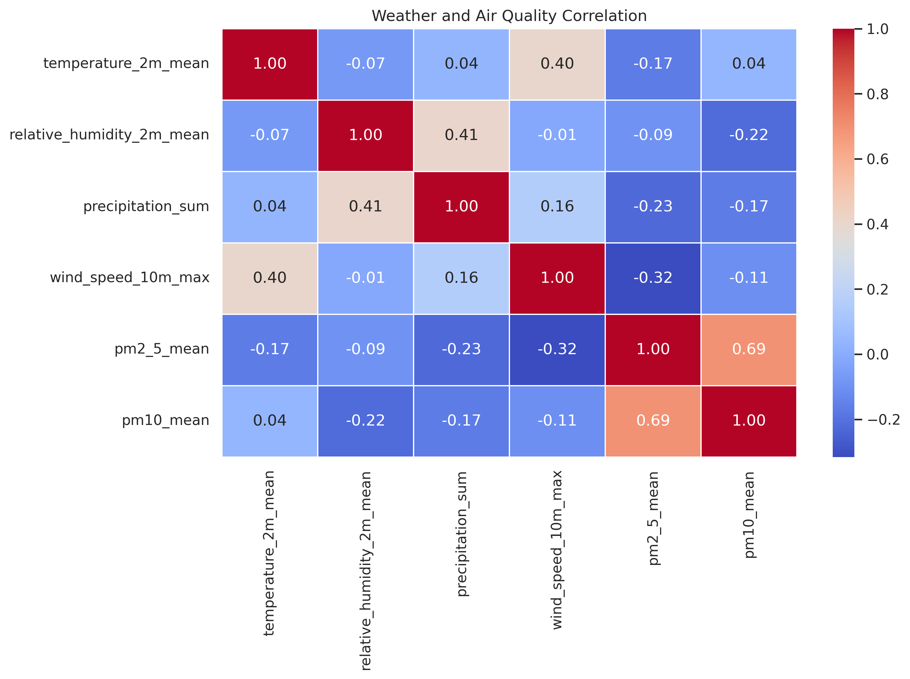

# Weather Meets Pollution

## Project Overview

This project analyzes weather conditions and air quality
across different cities in India.

The main objective is to understand pollution patterns
and explore the relationship between weather conditions
and PM2.5 levels.

## Project Objectives

- Analyze air quality across Indian cities.
- Identify cities with higher and lower average PM2.5.
- Analyze monthly pollution patterns.
- Explore weather and pollution relationships.
- Create meaningful data visualizations.

## Technologies Used

- Python
- NumPy
- Pandas
- Matplotlib
- Seaborn
- Google Colab

## Project Workflow

1. Data Collection
2. Data Exploration
3. Data Cleaning
4. Data Merging
5. Exploratory Data Analysis
6. Data Visualization
7. Findings and Insights

## Key Findings

Findings will be updated using the actual
results obtained from the analysis.

## Data Visualizations

### 1. Correlation Heatmap

### 2. PM2.5 Distribution

### 3. Top 10 Polluted Cities

### 4. PM2.5 Boxplot

### 5. Pairplot

## Conclusion

This project demonstrates how Python libraries
can be used to explore environmental data,
identify patterns, and communicate insights
through data visualization.

## Author

Karthiganandhini
