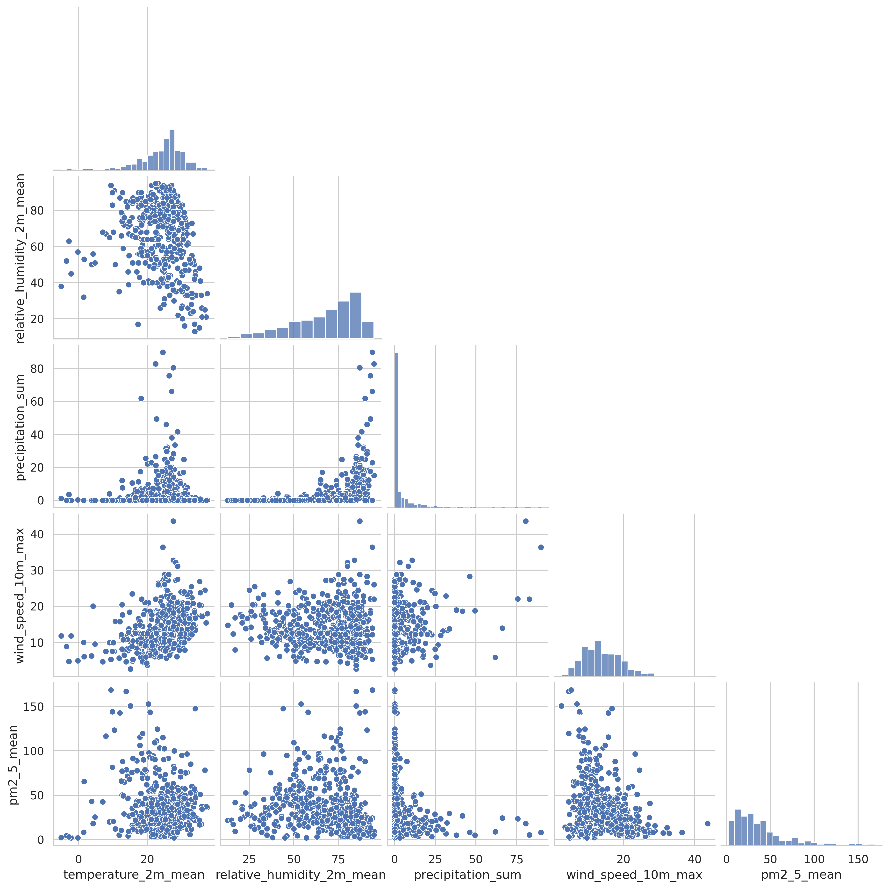

# Weather Meets Pollution

## Project Overview

This project analyzes weather conditions and air quality
across different cities in India.

The main objective is to understand pollution patterns
and explore the relationship between weather conditions
and PM2.5 levels.

## Project Objectives

- Analyze air quality across Indian cities.
- Identify cities with higher and lower average PM2.5.
- Analyze monthly pollution patterns.
- Explore weather and pollution relationships.
- Create meaningful data visualizations.

## Technologies Used

- Python
- NumPy
- Pandas
- Matplotlib
- Seaborn
- Google Colab

## Project Workflow

1. Data Collection
2. Data Exploration
3. Data Cleaning
4. Data Merging
5. Exploratory Data Analysis
6. Data Visualization
7. Findings and Insights

## Key Findings

- Analyzed air quality and weather data across 50 Indian cities.
- Processed 78,500 records for the analysis.
- Delhi recorded the highest average PM2.5 level.
- Leh recorded the lowest average PM2.5 level.
- January recorded the highest average PM2.5 level.

### 1. Correlation Heatmap

### 2. Pairplot

## Conclusion

This project helped me gain practical experience in data analysis using Python.

I used Pandas for data cleaning and analysis, and Matplotlib and Seaborn for data visualization.

Through this project, I explored air quality patterns across Indian cities and analyzed the relationship between weather conditions and PM2.5 levels.

This project improved my skills in data preprocessing, exploratory data analysis, and extracting meaningful insights from real-world datasets.

## Author

Karthiganandhini
